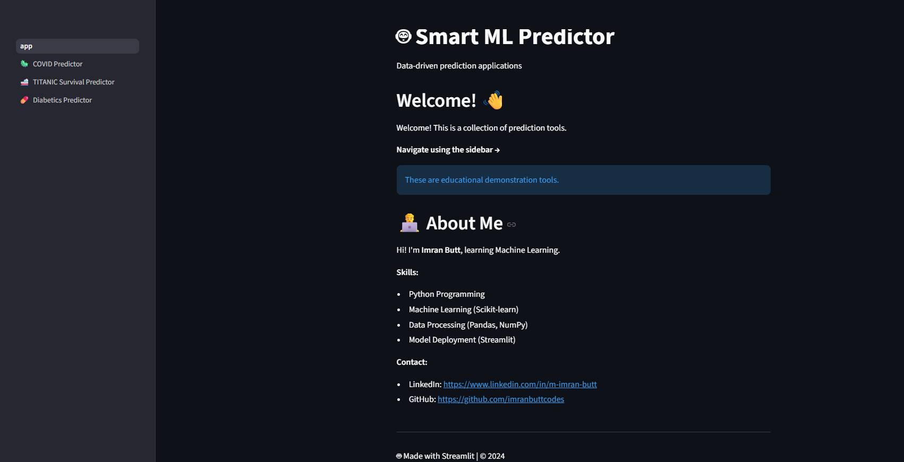
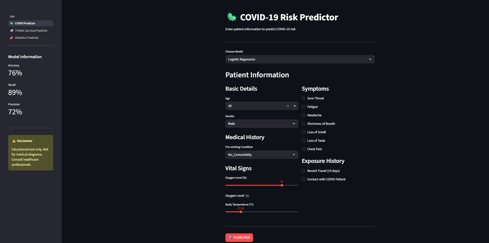
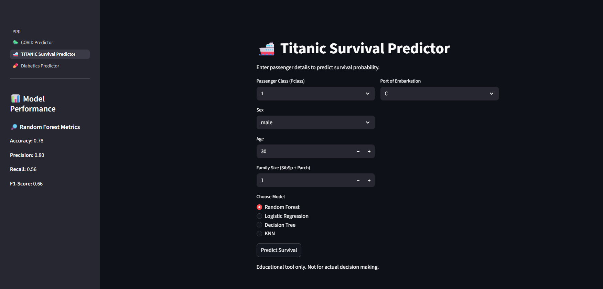
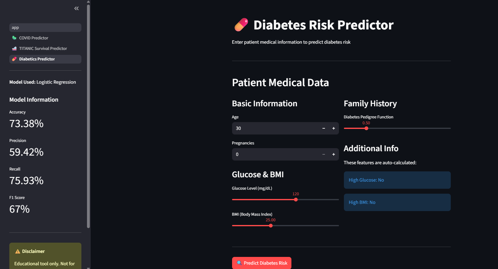

# 🤖 Smart ML Predictor

**Smart ML Predictor** is an educational collection of interactive machine learning prediction tools built with **Python** and **Streamlit**.  
It allows users to make predictions and generate PDF reports for:

- 💊 **Diabetes Risk Prediction**
- 🚢 **Titanic Survival Prediction**
- 🦠 **COVID-19 Risk Prediction**

---

## 📌 Features

- Interactive **Streamlit UI** for user-friendly input.
- Predict outcomes using **trained ML models**:
  - Logistic Regression, Random Forest, Decision Tree, KNN.
- **PDF report generation** with:
  - Patient/passenger details
  - Prediction results
  - Probability charts
  - Recommendations
- Sidebar displays **model performance metrics** (accuracy, precision, recall, F1-score).
- Educational demonstration — **not for real medical or life-critical decisions**.

---

## 🛠️ Technologies Used

- Python 3.10+
- Streamlit
- Pandas & NumPy
- Scikit-learn
- Matplotlib
- FPDF
- Joblib

---

## 📁 Project Structure
SmartMLPredictor/
│
├── app.py                    # Main Streamlit app launcher
├── requirements.txt          # Python dependencies
├── README.md                 # Project documentation
│
├── models/                   # Pre-trained models & transformers
│   ├── diabetes_model.joblib
│   ├── diabetes_scaler.joblib
│   ├── rf_titanic_model.joblib
│   ├── lg_titanic_model.joblib
│   ├── dt_titanic_model.joblib
│   ├── knn_titanic_model.joblib
│   ├── titanic_encoder.joblib
│   ├── titanic_scaler.joblib
│   ├── corona_lg_model.joblib
│   ├── corona_rf_model.joblib
│   └── preprocessor.joblib
│
├── pages/                    # Individual app pages for Streamlit
│   ├── 1_Diabetes_Predictor.py
│   ├── 2_Titanic_Survival_Predictor.py
│   └── 3_COVID19_Risk_Predictor.py
│
├── screenshots/              # Screenshots for README.md
│   ├── home.png
│   ├── diabetes.png
│   ├── titanic.png
│   └── covid.png


## 🚀 Installation

1. Clone the repository:

```bash
git clone https://github.com/imranbuttcodes/SmartMLPredictor.git
cd SmartMLPredictor

Create a virtual environment (recommended):

python -m venv venv
# Activate the environment
# Windows:
venv\Scripts\activate
# Linux/macOS:
source venv/bin/activate

Install dependencies:

pip install -r requirements.txt

Run the main page:

streamlit run app.py

Navigate between modules using the sidebar.

Fill in input data and click Predict.

Download PDF reports with prediction summary, recommendations, and probability charts.

📋 Modules Overview
💊 Diabetes Risk Predictor

Inputs: Age, Pregnancies, Glucose, BMI, Diabetes Pedigree Function, etc.

Output: High/Low Risk.

PDF report: Includes probability chart and recommended actions.

🚢 Titanic Survival Predictor

Inputs: Passenger Class, Sex, Age, Family Size, Port of Embarkation.

Output: Survival Probability using selected model (RF, LG, DT, KNN).

PDF report: Probability chart and passenger details.

🦠 COVID-19 Risk Predictor

Inputs: Age, Gender, Comorbidities, Symptoms, Vital Signs, Exposure History.

Output: High/Low Risk.

PDF report: Probability chart and recommendations for precautions.

⚠️ Disclaimer

This project is for educational purposes only.
Predictions are not medical advice or real-life decision-making tools. Always consult a professional for health or safety concerns.

📫 Contact

Muhammad Imran Butt

LinkedIn: https://www.linkedin.com/in/m-imran-butt

GitHub: https://github.com/imranbuttcodes

🎨 Screenshots





